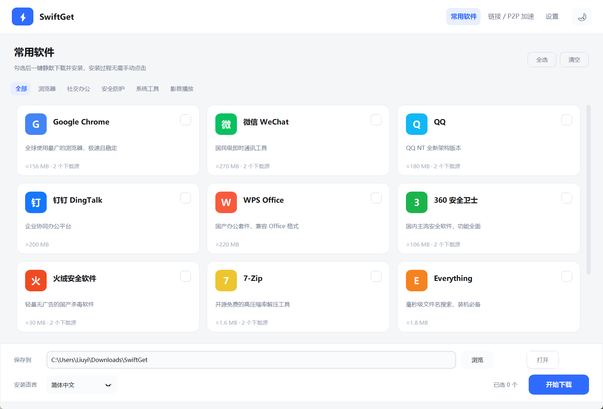
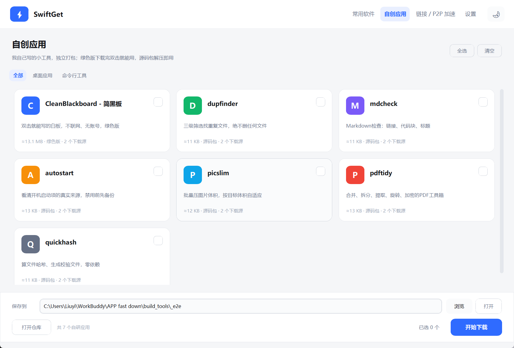

# SwiftGet · 极速软件下载器

[](https://github.com/liuyichen27/SwiftGet/releases)
[](https://github.com/liuyichen27/SwiftGet/releases)
[](LICENSE)

一个简洁、开源、全自动的软件下载器。勾选常用软件，选好路径和语言，
剩下的下载与安装全部在后台静默完成。Windows 绿色单文件，Linux 走 deb。

**[⬇ 下载最新版](https://github.com/liuyichen27/SwiftGet/releases/latest)** · Windows：单文件绿色版，解压即用 · Linux：`swiftget_<版本>_all.deb`



## 特性

- **常用软件一键静默安装** —— 内置 12 款高频软件，勾选后自动下载 + 静默安装，
  全程无弹窗、无捆绑引导。
- **自创应用** —— 单独一页放作者自己写的 8 个小工具（CleanBlackboard 简黑板、
  AutostartForApp 启动项管理、dupfinder、mdcheck、autostart、picslim、pdftidy、
  quickhash），绿色版下载完直接双击，源码包下载完解压即用，不经过安装流程。
  每条链接各走各的版本号，某个项目升版不会把其它项目的下载地址带成 404。
- **自己也能更新** —— 设置页「关于」里有「检查更新」，启动时也会在后台静默查一次；
  发现新版就下载、校验 PE 头、写一个替换脚本等你退出后覆盖自身并重启。
- **双引擎加速**
  - 直链下载：多线程分片（默认 16 连接），服务器支持 `Range` 时明显提速。
  - BitTorrent：支持磁力链与 `.torrent` 种子，通过 DHT + Peer Exchange 从
    多节点并行拉取。
- **多源自动切换** —— 每个软件配置多个下载源，下载前自动预检，
  优先使用可用源；某源失效不影响整体流程。
- **可维护的软件清单** —— 清单可导出、可编辑，也支持从远程 JSON 地址热更新，
  链接失效无需重新打包。
- **安装语言可选** —— 对支持语言参数的安装包（如 VLC）可指定中文/英文安装界面，
  其余安装包会自动跟随系统语言并在界面提示。
- **轻量无依赖** —— 单文件 exe，内嵌 aria2 内核，不需要额外安装运行库。

## 软件静默能力

不是所有软件官方安装包都支持完全静默，这是安装器本身决定的。本工具按下表处理：
支持静默的直接装完，不支持的会自动把安装向导弹出来，你只需点几下。

| 软件 | 安装方式 | 说明 |
| --- | --- | --- |
| Google Chrome | 全静默 | MSI 企业版，`/qn` |
| 微信 WeChat | 全静默 | NSIS `/S` |
| QQ | 全静默 | `/S` |
| 钉钉 DingTalk | 全静默 | `/S` |
| 火绒安全软件 | 全静默 | `/S` |
| 7-Zip | 全静默 | `/S` |
| Everything | 全静默 | `/S` |
| Notepad++ | 全静默 | `/S` |
| VLC media player | 全静默 | `/S`，支持 `/L=` 指定语言 |
| WPS Office | 自动打开向导 | 安装器强制显示界面 |
| 360 安全卫士 | 自动打开向导 | 会弹出组件选择 |
| Bandizip | 自动打开向导 | 会要求选择版本类型 |

卡片上会直接标出「需手动确认安装」，勾选时底部也会提示有几个软件需要手动。

## Linux（Debian / Ubuntu）

```bash
sudo apt install ./swiftget_1.3.0_all.deb
swiftget              # 或从应用菜单点「极速下载器」
swiftget --check      # 装完先跑这个：缺哪个依赖它会直接告诉你怎么补
```

**为什么 Linux 版是源码包而不是单文件**：PyInstaller 不能交叉编译，Windows 上跑不出
一份 Linux 可执行文件。所以这个 deb 是 `Architecture: all`——里面放 Python 源码、界面资源，
以及打包进去的 `customtkinter` / `darkdetect`（Debian 仓库里没有这两个包，又不能让你
`pip install` 到系统 Python 里）。运行时用系统的 `python3` + `python3-tk`。

| 依赖 | 作用 |
| --- | --- |
| `python3-tk` | tkinter，界面底座 |
| `python3-requests` | 查清单、预检下载源 |
| `python3-pil` / `python3-packaging` | customtkinter 的依赖 |
| `aria2` | 下载内核（多线程分片 + BT） |

`Recommends` 里还有 `fonts-noto-cjk`（没中文字体会整屏方块）、`xdg-utils`（打开所在文件夹）、
`pkexec`（装 deb 时的图形授权弹窗）。

Linux 上「安装」不再是 exe 加静默参数，而是按包类型分流：

| 下载到的文件 | 怎么处理 |
| --- | --- |
| `.deb` | `pkexec apt install`（弹一次密码框），apt 会给解依赖 |
| `.tar.xz` / `.tar.gz` | 解到 `~/.local/opt/<id>`，在 `~/.local/bin` 建同名软链 |
| `.AppImage` | `chmod +x` 后收进 `~/.local/bin` |

刻意不碰 `/usr/local`、不动系统目录：用户装的东西都落在自己家目录下，卸载就是删文件夹。

## 使用

1. 双击 `SwiftGet.exe` 启动（Linux 上敲 `swiftget`）。
2. 在「常用软件」页勾选需要的软件，选择保存路径与安装语言；
   也可以在「自创应用」页下载作者自研的工具。
3. 点击「开始下载」，程序会预检源、下载、校验并静默安装。
4. 安装阶段首次会弹出一次 UAC 授权，点「是」即可（程序本身以普通权限运行，
   仅在真正安装时提权）。

「链接 / P2P 加速」页可以直接粘贴直链、磁力链，或选择 `.torrent` 种子文件。

「自创应用」页是作者自研的小工具集合，走同一套多线程下载，但**没有安装环节**：



| 应用 | 类型 | 下载后 |
| --- | --- | --- |
| CleanBlackboard - 简黑板 | 绿色版 exe | 双击直接运行，无安装、无残留 |
| dupfinder / mdcheck / autostart / picslim / pdftidy / quickhash | 源码包 zip | 解压后 `pip install .`，零依赖或少量依赖 |

每个应用都配了「官方直链 + gh-proxy 加速镜像」两个源，国内直连 GitHub 超时时
会自动切到镜像；卡片下载完只显示「已保存」，不会去装任何东西。

## 软件清单与源维护

内置清单在 `src/core/catalog.py`（Windows）和 `src/core/catalog_linux.py`（Linux，
chrome / edge / vscode 走 deb，firefox 走 tar.xz）。运行时的覆盖文件位于：

```
%APPDATA%\SwiftGet\catalog.json
```

修改该文件（或在「设置 → 高级」中配置远程清单地址）即可在不重新打包的情况下
修复链接、增删软件。远程清单格式：

```json
{
  "version": 1,
  "apps": [
    {
      "id": "chrome",
      "name": "Google Chrome",
      "sources": [
        { "url": "https://example.com/chrome.msi", "label": "官方" }
      ],
      "installer": "msi",
      "silent_args": ["/qn", "/norestart"]
    }
  ]
}
```

字段说明：

| 字段 | 说明 |
| --- | --- |
| `installer` | `msi` 走 `msiexec /i ... /qn`；`exe` 直接执行安装包 |
| `silent_args` | exe 安装包的静默参数，如 NSIS 的 `/S`、Inno 的 `/VERYSILENT` |
| `lang_args` | 可选，形如 `{"zh": ["/L=2052"], "en": ["/L=1033"]}` |
| `sources` | 数组，按顺序预检，第一个可用源会被使用 |

## 从源码运行 / 打包

```bash
python -m venv .venv
.venv/Scripts/pip install -r requirements.txt
.venv/Scripts/python src/main.py            # 直接运行
.venv/Scripts/python build_tools/build.py   # 打包单文件 exe -> dist/SwiftGet.exe
```

需要 Python 3.10+ 且带 `tkinter`（Windows 官方安装包默认包含）。

## 目录结构

```
src/
  main.py                入口
  core/
    paths.py             路径与资源定位
    settings.py          设置持久化
    catalog.py           软件清单 / 多源 / 预检
    own_apps.py          自创应用清单（作者自研工具）
    aria2.py             aria2 RPC 引擎（分片 + P2P）
    installer.py         静默安装与提权
  ui/
    app.py               主窗口与调度
    page_apps.py         常用软件页
    page_own.py          自创应用页
    page_link.py         链接 / P2P 页
    page_settings.py     设置页
    widgets.py           卡片、任务行等组件
    theme.py             配色与字体
assets/
  aria2c.exe             下载内核
  app.ico                应用图标
```

## 常见问题

**某个软件下载失败怎么办？**
程序会提示「所有下载源都不可用」。软件官方直链会随版本变化，可在
「设置 → 高级 → 导出清单」拿到当前清单，修改后放到
`%APPDATA%\SwiftGet\catalog.json`，或配置远程清单地址统一维护。

**为什么 P2P 对常用软件没有加速效果？**
BitTorrent 需要有人做种。Chrome、微信这类软件官方只提供 HTTP 直链，
没有公开种子源，因此走多线程分片加速。P2P 适用于你手上的磁力链和种子文件。

**语言选了但安装界面没变？**
多数 Windows 安装包把语言编译进包里，运行时无法切换。只有 VLC 这类
支持 `/L=<LCID>` 的安装包能生效，界面会在选择时提示。

**杀毒软件报毒？**
PyInstaller 打包的 exe 常被启发式引擎误报。本项目完全开源，可自行审阅源码并
用 `build_tools/build.py` 重新打包。

**安装时没有静默执行？**
部分安装包（如 360）本身不支持完全静默，会显示安装界面。此时按提示点击即可。

## 免责声明

本工具仅提供下载与安装流程的自动化，所有安装包均直接来自软件官方或公开镜像，
不经过任何中转服务器，也不修改安装包内容。请在遵守各软件许可协议的前提下使用。

## 许可

MIT License，详见 [LICENSE](LICENSE)。
